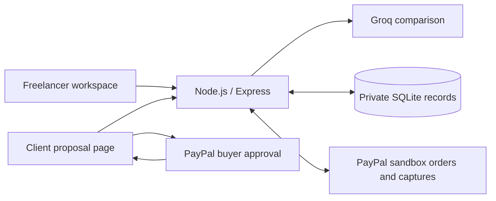

# ScopeShield

<p align="center">
  
</p>

**Turn extra client requests into reviewed, approved, paid work.**

ScopeShield helps a freelancer compare a new client request with an existing agreement, review an AI explanation of potential extra work, publish fixed proposal terms, and collect payment through PayPal sandbox.

[Public source repository](https://github.com/aatish1321/ScopeShield) · [MIT license](LICENSE)

## What to evaluate

A freelancer agreed to build a three-page website. The client then asks for a ten-product online store. ScopeShield connects the agreement comparison to a concrete change proposal and client payment workflow:

1. Paste the original agreement and the client's new request.
2. Groq classifies the request as potential additional work, already included, or unclear, with source excerpts and an explanation.
3. The freelancer edits the added work, USD price, and delivery change, then explicitly approves publication.
4. A private, unguessable client link shows only those fixed terms.
5. The client accepts the proposal and approves payment in PayPal sandbox.
6. The server captures the stored order and verifies PayPal's order, merchant, reference, amount, currency, and capture status before showing **Paid** and the transaction reference.

AI does not set binding prices, promise delivery dates, send messages, or charge clients automatically. A freelancer reviews its interpretation and makes those decisions.

## Current verification status

| Check | Evidence |
| --- | --- |
| Automated behavior and security checks | `npm test`: 46 passing tests, including the complete HTTP payment journey with mocked PayPal responses |
| Real Groq access | Synthetic additional, included, and unclear cases exercised successfully, including the multiline website/store example |
| Persistence | A published synthetic proposal and its original client link survived an actual application restart |
| Real PayPal sandbox access | OAuth, order creation, and order retrieval passed; stored USD amount, reference, merchant, and approval destination verified |
| Buyer approval and live sandbox capture | **Awaiting hands-on verification with a sandbox buyer**; automated capture tests use mocked responses |
| Repository and licensing | Public GitHub repository; top-level MIT license recognized by GitHub |
| Browser visual/keyboard review | Initial comparison flow tried by the builder; full client checkout review is still pending |

The payment implementation is available for testing. The submission demo video has not been recorded yet. No real-money payment flow is enabled.

## Setup and run

### Requirements

- Node.js **24.13 or newer**, with built-in SQLite support; developed and tested on Node 26.
- npm.
- A Groq API key with access to a model supporting strict structured output.
- For the complete demo, PayPal sandbox app credentials and a separate sandbox buyer account.

A hosted demo is not required to run this project. Judges can clone and run it locally using these instructions.

```sh
git clone https://github.com/aatish1321/ScopeShield.git
cd ScopeShield
npm ci
cp .env.example .env
chmod 600 .env
```

The copy command is for a fresh clone. Preserve an existing `.env` rather than overwriting it.

Open `.env` in your editor and configure:

| Variable | Purpose |
| --- | --- |
| `GROQ_API_KEY` | Server-side Groq credential; required for startup |
| `GROQ_MODEL` | Defaults to `openai/gpt-oss-20b`, hosted by **Groq**; no OpenAI API key is needed |
| `OWNER_ACCESS_KEY` | Private freelancer login credential; use a randomly generated value of at least 32 characters |
| `PAYPAL_CLIENT_ID` | Client ID from your PayPal **Sandbox / Merchant** app |
| `PAYPAL_CLIENT_SECRET` | Secret from that same sandbox app; required together with the client ID |
| `APP_URL` | Browser origin, normally `http://localhost:3000`; used for trusted host/origin checks and PayPal return URLs |
| `PORT` | Local server port; defaults to `3000` |
| `NODE_ENV` | `development` locally; production configuration requires HTTPS |

Generate your own owner login key locally:

```sh
openssl rand -hex 32
```

Paste the generated value into `OWNER_ACCESS_KEY` in `.env`. Do not commit it. Do not use example/test credentials from source code.

Start the app:

```sh
npm start
```

Open **http://localhost:3000**. Log in with your configured owner key.

Both PayPal fields can be left blank to explore the AI/proposal flow with checkout disabled. The complete judge demo requires both. If only one is set, startup fails with a configuration error.

### Obtain provider credentials

**Groq:** create an API key in [Groq Console](https://console.groq.com/keys). The configured model must support [strict structured outputs](https://console.groq.com/docs/structured-outputs). Account access, limits, and billing depend on your Groq account.

**PayPal:** open the [Developer Dashboard](https://developer.paypal.com/dashboard/), choose **Apps & Credentials → Sandbox**, create a **Merchant** app attached to a sandbox business account, and copy its client ID and secret. A credential labeled **Secret 1** is usable as the app's client secret. See [PayPal setup](https://developer.paypal.com/api/get-started/).

For buyer checkout, use **Testing Tools → Sandbox Accounts** to obtain the email/password for a separate **personal** sandbox account. The business account receives the test payment; the personal account pays. These account login credentials are different from the app's client ID/secret. Do not use your real account login at sandbox checkout.

## Demo walkthrough

1. Log in to the freelancer workspace and click **Load website example**. This loads synthetic text, not a canned AI result.
2. Click **Analyze request**. Inspect the classification, quoted source evidence, and explanation from a real Groq call.
3. Edit the proposal: title `Add a ten-product store`, work `Product catalog, shopping cart, PayPal checkout, and product management`, price `250.00`, delivery change `Five additional working days`.
4. Check the freelancer review confirmation and click **Approve and publish proposal**.
5. Open the resulting client link in a separate browser or private window on the same computer. It requires no owner login and shows only approved terms.
6. Check the client acceptance box, then continue to PayPal sandbox. Sign in with the separate sandbox buyer account and approve the payment.
7. On return, ScopeShield requests server-side capture and verifies the actual PayPal order. A redirect or query parameter alone never marks a proposal paid.
8. Confirm **Paid** and the sandbox transaction reference on the client page. Refresh the freelancer's proposal list or use **Check payment status**.
9. Reopen the paid link: no second checkout is offered. Restarting the app preserves the proposal and its payment record.

For cancellation, publish another synthetic proposal, start checkout, and cancel in PayPal. Cancellation must not report a successful payment. Retry uses the existing saved order rather than creating a new one.

To exercise other AI outcomes, request a contact form already included in the agreement, or ask for an unnamed feature from an unavailable prior discussion. Expected outcomes are **included** and **unclear**, respectively; all AI interpretations remain subject to human review.

Localhost links work only on the computer running the server. To let remote users follow a link, deploy behind HTTPS with the correct `APP_URL` and a persistent database volume; this repository does not provision hosting.

## How PayPal and AI are used

**Groq** performs the core agreement comparison through `POST /openai/v1/chat/completions`. The server supplies a strict JSON schema and treats both documents as untrusted input. It validates the response and source quotes, permitting whitespace-only differences. Invalid evidence gets one corrective attempt; repeatedly invalid output is rejected. This retry may consume an additional API request. No fake AI fallback exists in the application.

**PayPal Orders v2** completes the proposal's payment workflow: server-side OAuth, create order, redirect for buyer approval, capture the stored order, and retrieve the order to reconcile its actual state. The sandbox API host is fixed in code. The browser cannot choose the charge amount, currency, merchant, or order ID. [Orders API documentation](https://developer.paypal.com/api/orders/v2/)



The UI uses plain HTML/CSS/JavaScript. Express is the only installed runtime dependency; Node provides fetch, cryptography, SQLite, and the test runner.

## Security and data boundaries

- Secrets stay in server-side `.env`. `.gitignore` excludes environment variants, runtime databases/journals, private keys, dependencies, and local workflow files. Only `.env.example` with blank credential fields is committed. Ignore rules do not remove previously tracked files; staged contents must also be reviewed.
- Login uses a random, eight-hour, server-managed session. The server stores a hash of the session token; its cookie is HttpOnly, SameSite=Strict, and Secure over configured HTTPS. Logout or server restart invalidates the session.
- No localStorage or sessionStorage is used. Unpublished agreement text, analysis, and draft edits remain in page memory and clear on reload/logout. Published terms and payment metadata persist in `data/scopeshield.sqlite`; the app does not retain the original agreement/request or raw AI analysis in that database.
- Groq receives submitted document text for analysis. Use synthetic data for evaluation and review [Groq's data policy](https://console.groq.com/docs/your-data) before supplying confidential client material.
- Only `public/` is web-served. Environment files, source, Git metadata, database files, and local plans are not accessible over HTTP. The local `.env` and database use `0600` permissions; the data directory uses `0700`.
- Owner APIs require an unexpired session. State-changing requests require the exact configured Origin and JSON content type. Host checks resist DNS rebinding; proxy headers are not trusted. Login, analysis, publishing, and payment operations are throttled.
- User and AI content renders as text rather than HTML. Responses use no-store/no-referrer, a restrictive CSP, anti-framing, and content-type protections. Sandbox approval destinations are allowlisted.
- USD amounts are parsed as integer cents and fixed at publication. Database rules prevent later edits to published terms. Client links are random capability URLs: **anyone holding a link can view and interact with that proposal**, so share them only with intended recipients.
- Separate create/capture request IDs are saved before external calls. In-process per-proposal locking blocks concurrent payment operations. Timeouts are reconciled against the existing order. Paid/pending proposals cannot start new charges, and unverifiable states are never presented as confirmed payment.
- Uncertain operations beyond the conservative five-hour recovery window require manual reconciliation. An expired, voided, or irrecoverably failed order is not silently replaced. Do not issue a replacement payment request until the original outcome is confirmed.

These are implemented and tested prototype controls, not a guarantee of production security. Back up the private database if its records matter; losing it also loses payment reconciliation references.

## Tests and troubleshooting

```sh
npm test
```

The 46 checks cover authentication, session expiry/logout, CSRF/origin checks, private-file isolation, safe text rendering, input/evidence validation, exact money parsing, immutable terms, restart persistence, client/owner isolation, acceptance, payment idempotency, concurrent requests, timeouts, pending/failed/completed states, and amount/currency/reference/merchant mismatches.

Automated Groq/PayPal responses are mocked. The verification table above distinguishes these tests from actual external API checks.

| Symptom | What to check |
| --- | --- |
| Startup says a key is missing | Fill the named entry in local `.env`, then restart |
| Login fails | Use `OWNER_ACCESS_KEY`, not a provider credential; restarts require a fresh login |
| Host/origin rejected | Open the exact `APP_URL`, including hostname and port |
| Groq rejects the model/schema | Configure a Groq model supporting strict structured output |
| Invalid comparison evidence | The model could not quote the source faithfully after its bounded retry; retry or clarify the text, and review its reasoning |
| Rate limit | Wait before retrying; check the provider's account limits too |
| PayPal checkout unavailable | Configure both sandbox app credentials and restart |
| Wrong account at checkout | Use a separate personal sandbox buyer, not the receiving business account |
| Payment pending/unknown | Use **Check payment status**; do not create a replacement charge |
| Port already in use | Stop the previous server, or update both `PORT` and local `APP_URL` consistently |

## Prototype limits

Single freelancer, single server process, USD only, pasted text, fixed published proposals, and sandbox payments. No account registration, teams, email delivery, file extraction, automatic pricing, real-money mode, background webhooks, refunds/disputes, or multiple server replicas. Payment state is refreshed on demand. Visual polish and deployment are deferred.

## Source map and license

- `src/server.js`: HTTP routes, owner sessions, request boundaries, and startup.
- `src/analysis.js`: Groq prompt, schema, evidence validation, and bounded correction.
- `src/validation.js`: configuration, text, review confirmation, and exact USD amounts.
- `src/store.js`: private SQLite records, immutable terms, and payment metadata.
- `src/paypal.js`: sandbox OAuth, order creation, capture, reconciliation, and retry protection.
- `public/`: freelancer and client interfaces.
- `test/`: synthetic automated checks; no real API secrets.

All project source, assets, and run instructions are in this public repository. Source is available under the **MIT License**, provided in the top-level [LICENSE](LICENSE) file.
